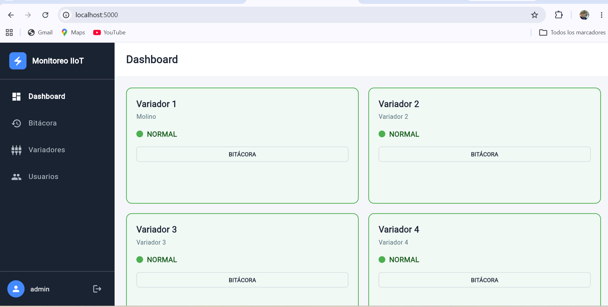

# Sistema IIoT de Monitoreo y Control de Variadores

Proyecto de grado para optar al título de Ingeniería en Sistemas. Sistema Full-Stack para el monitoreo en tiempo real y reset remoto de variadores de frecuencia industriales.

## 🛠️ Tecnologías Utilizadas
* **Hardware:** ESP32, MQTT (Mosquitto), C++ (PlatformIO)
* **Backend:** Node.js, Express, MySQL, JWT
* **Frontend:** Flutter Web (Dart)
* **Notificaciones:** Telegram Bot API

## 🧪 Enfoque QA (Quality Assurance)
Este proyecto no solo fue desarrollado, sino **exhaustivamente probado**.
* Se diseñaron y ejecutaron **65 casos de prueba** (Funcionales, Integración, Seguridad y Regresión).
* Se detectaron y corrigieron **11 bugs críticos** antes de la entrega.
* 📄 [Informe Completo de Pruebas aquí](./Docs/informe_pruebas.txt)
* 📘 [Manual de Usuario aquí](./Docs/manual_usuario.txt)

## 📸 Evidencias
Aquí puedes ver el dashboard del sistema en funcionamiento:

## 🚀 Cómo ejecutar el proyecto localmente
1. Clonar el repositorio.
2. Configurar las variables de entorno (`.env` y `secrets.h`).
3. Instalar dependencias del backend: `cd backend && npm install`
4. Iniciar el broker MQTT.
5. Iniciar el backend: `node server.js`
6. Iniciar el frontend: `cd frontend && flutter run -d web-server --web-port=5000`

---
*Desarrollado por [JorgeFranciscoSantos] - [jorgesanto462@gmail.com]*